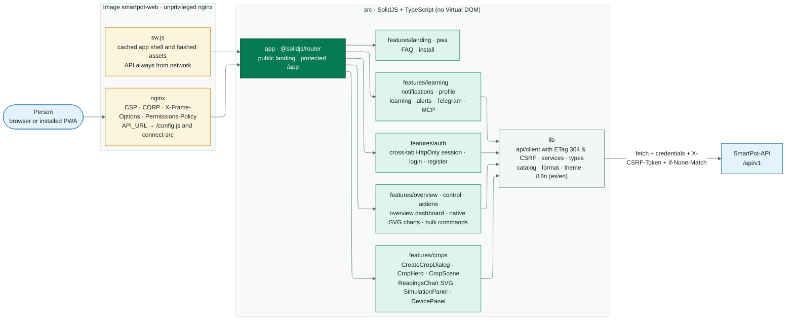
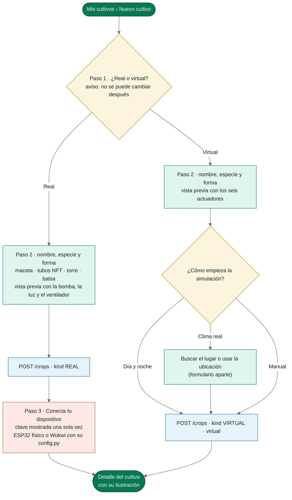
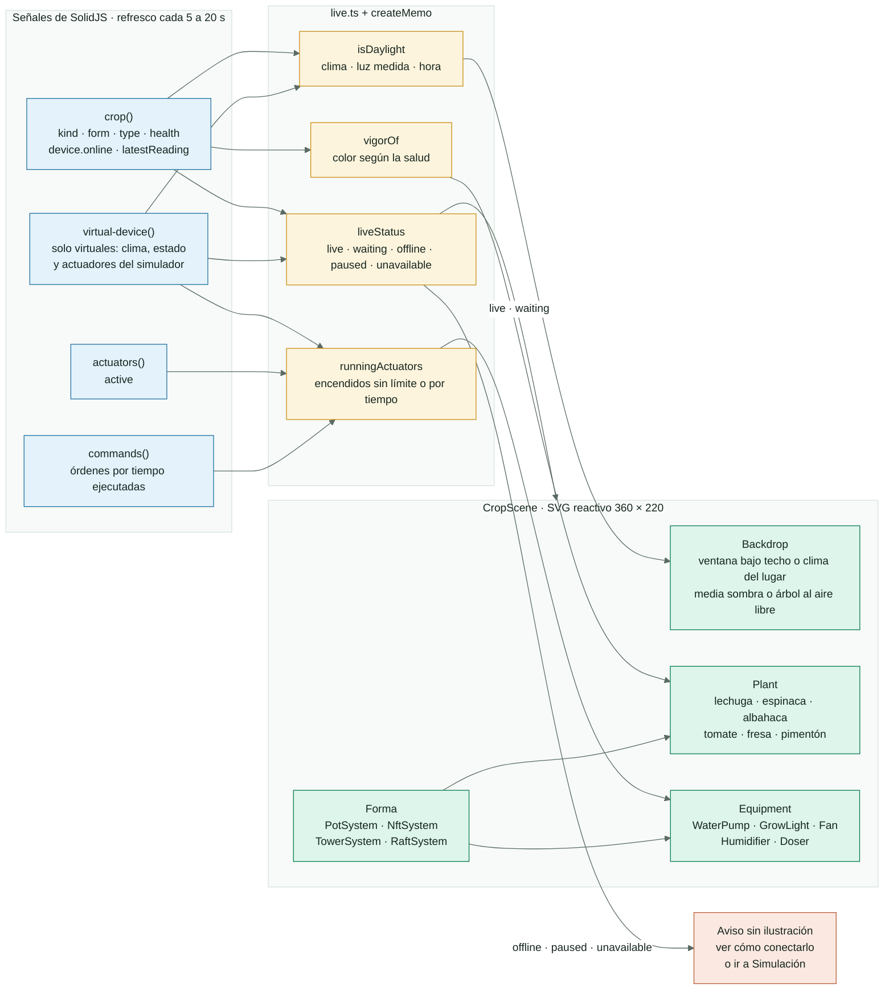
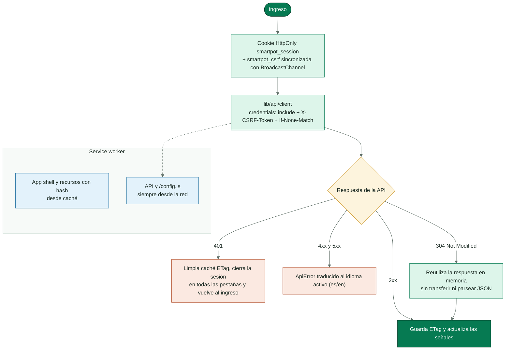

<!-- portada
eyebrow: Component Documentation · Documentación del componente
titulo: SmartPot-Web
acento: Web
subtitulo: Next-Generation Progressive Web App · Aplicación web progresiva de nueva generación
bajada: Installable SolidJS PWA without Virtual DOM: overview dashboard, native SVG charts, conditional ETag revalidation, live SSE streaming, real and virtual crops, reactive SVG crop scene, AI assistant, control, continuous learning, alerts, Telegram, MCP connections, dark mode, and full English/Spanish i18n.
documento: SmartPot-Web
version: 1.1 · November 2026
equipo: SmartPotTech
proyecto: smartpot.app
-->

# SmartPot-Web

[English](#1-purpose) | [Español](#9-propósito-español)

<!-- parte: PART I · EN | The Component (English) -->

## 1. Purpose

### Document Sheet

| Field                  | Value                                                                                                                                                                                                                                                                                                        |
|------------------------|--------------------------------------------------------------------------------------------------------------------------------------------------------------------------------------------------------------------------------------------------------------------------------------------------------------|
| Project                | SmartPot · [smartpot.app](https://smartpot.app)                                                                                                                                                                                                                                                              |
| Component              | [SmartPot-Web](https://github.com/SmartPotTech/SmartPot-Web)                                                                                                                                                                                                                                                 |
| Version                | 1.1 · November 2026                                                                                                                                                                                                                                                                                          |
| Scope                  | Reactive SolidJS architecture, screens, native SVG charts, crop creation, live SVG crop scene, cross-tab `HttpOnly` cookie session + CSRF, `ETag` cache, bilingual i18n (`en`/`es`), dark mode, web security, configuration, and tests                                                                     |
| Platform Documentation | [Migration Documentation](https://github.com/SmartPotTech/.github/blob/main/docs/SmartPot_Migration.md), [Technical Documentation](https://github.com/SmartPotTech/.github/blob/main/docs/SmartPot_Technical_Documentation.md), and [Project Journey](https://github.com/SmartPotTech/.github/blob/main/docs/SmartPot_Project_Journey.md) |
| Maintenance            | Generated from `docs/` in this repository using `.github/docs/tools`; updated alongside component changes                                                                                                                                                                                                    |

### In Plain Terms

`SmartPot-Web` is the Progressive Web Application (PWA) of SmartPot, built with **SolidJS + TypeScript + Vite**. It displays every crop live, compares sensor readings against the ideal range for its species, lets users create real or virtual crops, send actuator commands, and inspect what the AI assistant diagnoses and learns, while minimizing bundle size and browser work via fine-grained reactivity without a Virtual DOM, native SVG charts, live SSE streaming with LTTB downsampling, conditional `ETag` revalidation, dark mode, and full bilingual support (**English and Spanish**).

| Screen                        | Capabilities                                                                                                                                                                           |
|-------------------------------|----------------------------------------------------------------------------------------------------------------------------------------------------------------------------------------|
| Public Landing                | Product overview, features, supported species, and FAQ; search-engine indexable                                                                                                        |
| Overview Dashboard            | Health ranking of every crop, single-metric comparison in native SVG, latest readings table, and AI fleet analysis across the account                                                  |
| My Crops                      | Crop cards with kind, species, form, device status, and health; step-by-step creation wizard                                                                                           |
| Crop Detail                   | Live SVG illustration of the crop in its placement above all tabs: summary, AI assistant with placement advice, switch controls, history, device (real) or simulation (virtual), settings |
| General Control & Actions     | Automatic mode and bulk commands; AI-suggested fleet actions and command history                                                                                                       |
| Learning, Alerts & Profile    | Continuous AI learning metrics, notifications, Applications (Telegram), personal MCP connections (`spt_...`), profile data, and password                                               |

## 2. Component Architecture

<!-- diagrama: SmartPot_Web_Solid_Global_Component | titulo=SmartPot-Web Internal Architecture | lamina=H -->

Each domain feature lives in `src/features/<feature>` with its pages, components, and tests. `lib/api` is the single gateway to the API: it sends requests with `credentials: "include"` and `X-CSRF-Token`, manages the conditional `ETag` cache, maps errors to localized `ApiError` instances (`en`/`es`), and declares response types. `useResource` loads and refreshes SolidJS signals while the tab is visible.

<!-- parte: PART II · EN | Crops & Live Scene (English) -->

## 3. Creating a Crop

| Decision   | Detail                                                                                                                                                             |
|------------|--------------------------------------------------------------------------------------------------------------------------------------------------------------------|
| Kind       | Real (an ESP32 running the firmware, physical or in Wokwi) or Virtual (simulated by SmartPot). Cannot be changed later; Settings explains how to create another    |
| Form       | Pot, NFT tubes, vertical tower, or floating raft; can be changed in Settings and updates the live illustration                                                     |
| Placement  | Indoor or outdoor, sun exposure, and city/coordinates; editable in Settings                                                                                        |
| Preview    | Live SVG crop scene with the selected species, form, and initial actuators                                                                                         |
| Real       | Displays the device key once along with the wiring guide, firmware repository, and ready-to-copy `config.py` with WiFi and embedded Broker CA (`/ca.crt`)          |
| Virtual    | Day/night cycle, real local weather, or manual sliders; opens the crop with full simulation controls in the Simulation tab                                         |

## 4. Reactive Crop Illustration and Native SVG Charts

| Element            | Visual Representation                                                                                                                                                    |
|--------------------|--------------------------------------------------------------------------------------------------------------------------------------------------------------------------|
| Pot                | Reservoir with water pump, drip tube feeding the substrate, and nutrient/pH dosers on the lid                                                                            |
| NFT Tubes          | Three channels with four plants each, inlet manifold, and return line; nutrient film flows when the pump is active                                                       |
| Vertical Tower     | Column with staggered pockets; pump lifts the solution and droplets cascade inside                                                                                       |
| Floating Raft      | Deep-water basin with floating raft, submerged roots, and rising air-stone bubbles                                                                                       |
| UV Grow Light      | Overhead LED bar; illuminates the canopy when active                                                                                                                     |
| Fan & Humidifier   | Spinning blades with airflow lines; rising mist plume                                                                                                                    |
| Plants             | Species-accurate geometry (rosette lettuce, broadleaf spinach, paired basil leaves, staked tomato with flowers/fruit, strawberry, bell pepper) colored by health vigor   |

## 5. Session, Conditional ETag Cache, Internationalization, and Security

| Control               | Detail                                                                                                                                                                 |
|-----------------------|------------------------------------------------------------------------------------------------------------------------------------------------------------------------|
| CSP & CORP            | `script-src 'self'`, `style-src 'self'`, `connect-src` restricted to the API, and `Cross-Origin-Resource-Policy: same-origin`                                          |
| Security Headers      | `X-Frame-Options: DENY`, `nosniff`, `Referrer-Policy`, and `Permissions-Policy` (geolocation restricted to same-origin and explicit user action)                       |
| `ETag` Revalidation   | Client sends `If-None-Match` on `GET` requests; `SmartPot-API` replies `304 Not Modified` when unchanged and invalidates cache on any write                            |
| Session & CSRF        | `HttpOnly` cookie (`smartpot_session`) + signed double-submit CSRF token (`smartpot_csrf` / `X-CSRF-Token`), synchronized across tabs via `BroadcastChannel`           |
| Bilingual (`en`/`es`) | Reactive dictionary (`src/lib/i18n/en.ts`, `es.ts`) and dynamic API/AI message translation (`serverText.ts`) so the entire UI switches languages instantaneously       |
| Device Key            | Displayed only once upon real crop creation or key rotation                                                                                                            |

## 6. Configuration

| Variable       | Location              | Purpose                                                                                             |
|----------------|-----------------------|-----------------------------------------------------------------------------------------------------|
| `VITE_API_URL` | `.env` in development | Target API URL for `bun run dev`                                                                    |
| `API_URL`      | Container runtime     | Injected at startup into `/config.js` and the Nginx CSP header so a single image runs in any env    |
| `MCP_URL`      | Container runtime     | Optional public URL of `SmartPot-MCP` shown when generating MCP client snippets in Profile          |

## 7. Testing

Run `bun run lint`, `bun run typecheck`, `bun run test`, and `bun run build`. The Vitest and `@solidjs/testing-library` suite covers the HTTP client, `ETag` revalidation (`304 Not Modified`), `HttpOnly` session and CSRF flow, form validations, login, crop components, actuator switches, AI insights, continuous learning, Telegram channels, MCP connections, live SVG scenes, dark mode, `es`/`en` internationalization, and SEO/PWA compliance.

## 8. Operations

| Task          | Command / Mechanism                                                                                      |
|---------------|----------------------------------------------------------------------------------------------------------|
| Docker Image  | `ghcr.io/smartpottech/smartpot-web`: compiled with Bun Alpine and served by unprivileged Nginx           |
| `demo-beta`   | Runs as `web-smartpot` in `.github/docker/demo-beta/compose.yaml`                                        |
| Icons         | `bun run icons` regenerates all PWA PNG icons and Open Graph images from SVG sources                     |
| Browser Cache | Service worker version bump replaces the cached app shell on reload                                      |

<!-- parte: PARTE I · ES | El Componente (Español) -->

## 9. Propósito (Español)

### Ficha del documento

| Campo                          | Valor                                                                                                                                                                                                                                                                                                                                                                                                                                                   |
|--------------------------------|---------------------------------------------------------------------------------------------------------------------------------------------------------------------------------------------------------------------------------------------------------------------------------------------------------------------------------------------------------------------------------------------------------------------------------------------------------|
| Proyecto                       | SmartPot · [smartpot.app](https://smartpot.app)                                                                                                                                                                                                                                                                                                                                                                                                         |
| Componente                     | [SmartPot-Web](https://github.com/SmartPotTech/SmartPot-Web)                                                                                                                                                                                                                                                                                                                                                                                            |
| Versión                        | 1.1 · noviembre 2026                                                                                                                                                                                                                                                                                                                                                                                                                                    |
| Alcance                        | Arquitectura reactiva en SolidJS, pantallas, gráficos SVG nativos, creación de cultivos, ilustración del cultivo, sesión `HttpOnly` + CSRF sincronizada entre pestañas, caché ETag, soporte bilingüe (`es`/`en`), modo oscuro, identidad visual, seguridad web, configuración y pruebas                                                                                                                                                               |
| Documentación de la plataforma | [Documentación de migración](https://github.com/SmartPotTech/.github/blob/main/docs/SmartPot_Migration.md), [documentación técnica](https://github.com/SmartPotTech/.github/blob/main/docs/SmartPot_Technical_Documentation.md), [recorrido del proyecto](https://github.com/SmartPotTech/.github/blob/main/docs/SmartPot_Project_Journey.md) y [diagramas generales](https://github.com/SmartPotTech/.github/blob/main/docs/README.md#diagramas-generales) |
| Mantenimiento                  | Se genera desde `docs/` de este repositorio con las herramientas de `.github/docs/tools`; se actualiza con cada cambio del componente                                                                                                                                                                                                                                                                                                                   |

### En palabras simples

`SmartPot-Web` es la aplicación web progresiva (PWA) de SmartPot, construida en **SolidJS + TypeScript + Vite**. Muestra cada cultivo en vivo, lo compara con el rango ideal de su especie, permite crear cultivos reales o virtuales, dar órdenes a los actuadores y ver qué diagnostica y qué aprende el asistente de IA, reduciendo el peso del paquete y el trabajo del navegador mediante reactividad de grano fino sin Virtual DOM, gráficos SVG nativos, flujo en vivo por SSE con reducción LTTB, revalidación condicional por `ETag`, modo oscuro y soporte bilingüe completo (**español e inglés**).

| Pantalla                      | Qué permite                                                                                                                                                                                                                                     |
|-------------------------------|-------------------------------------------------------------------------------------------------------------------------------------------------------------------------------------------------------------------------------------------------|
| Inicio público                | Presentación, funciones, especies y preguntas frecuentes; indexable                                                                                                                                                                             |
| Panel general                 | Salud de cada cultivo, comparación de una variable en SVG nativo, últimas lecturas y análisis de la IA de toda la cuenta                                                                                                                        |
| Mis cultivos                  | Tarjetas con tipo, especie, forma, estado y salud; asistente de creación                                                                                                                                                                        |
| Detalle                       | La ilustración del cultivo en su lugar sobre todas las secciones: resumen, asistente IA con el consejo de lugar, control con switches, historial, dispositivo (reales) o simulación (virtuales) y ajustes con el lugar y los avisos del cultivo |
| Control general y acciones    | Modo automático y órdenes en bloque; sugerencias e historial de órdenes                                                                                                                                                                         |
| Aprendizaje, alertas y perfil | Lo que aprende la IA, notificaciones, Aplicaciones (Telegram), Conexiones MCP (`spt_...`), datos y contraseña                                                                                                                                   |

<!-- parte: PARTE II · ES | Cultivos e Ilustración (Español) -->

## 10. Crear un cultivo

<!-- diagrama: SmartPot_Web_Solid_01_Crop_Creation_Flow | titulo=Asistente para crear un cultivo -->

| Decisión     | Detalle                                                                                                                                                                                       |
|--------------|-----------------------------------------------------------------------------------------------------------------------------------------------------------------------------------------------|
| Tipo         | Real (un ESP32 con el firmware, físico o en Wokwi) o virtual (lo simula SmartPot). No cambia después; Ajustes lo muestra y explica cómo crear otro                                            |
| Forma        | Maceta, tubos NFT, torre vertical o balsa flotante; se puede cambiar en Ajustes y solo afecta la ilustración                                                                                  |
| Lugar        | Bajo techo o al aire libre, cuánto sol recibe y la ubicación; se puede cambiar en Ajustes                                                                                                     |
| Vista previa | La escena del cultivo con la especie y la forma elegidas y los actuadores con los que nace                                                                                                    |
| Real         | Muestra la clave una sola vez y la guía: circuito y pines, firmware y `config.py` con la red WiFi y la CA del broker (que toma de `/ca.crt`), o el proyecto de Wokwi con la red `Wokwi-GUEST` |
| Virtual      | Día y noche, clima real (buscador de lugares o ubicación del dispositivo) o manual; abre el cultivo y su configuración queda en la pestaña Simulación                                         |

## 11. Ilustración reactiva del cultivo y gráficos SVG nativos

<!-- diagrama: SmartPot_Web_Solid_02_Live_Scene | titulo=Cómo se dibuja la ilustración reactiva del cultivo | lamina=H -->

| Pieza                      | Qué dibuja                                                                                                                                                                                                                                                                            |
|----------------------------|---------------------------------------------------------------------------------------------------------------------------------------------------------------------------------------------------------------------------------------------------------------------------------------|
| Maceta                     | Depósito con la bomba, tubo que gotea sobre el sustrato y dosificadores sobre la tapa                                                                                                                                                                                                 |
| Tubos NFT                  | Tres tubos con cuatro plantas cada uno, colector de entrada y retorno al depósito; la película de solución corre si la bomba está encendida                                                                                                                                           |
| Torre vertical             | Columna con bolsillos escalonados; la bomba sube la solución y cae en gotas por dentro                                                                                                                                                                                                |
| Balsa flotante             | Estanque con la balsa, raíces en la solución y burbujas desde la piedra difusora                                                                                                                                                                                                      |
| Luz ultravioleta           | Barra con LED; encendida ilumina las plantas                                                                                                                                                                                                                                          |
| Ventilador y humidificador | Aspas que giran con corriente de aire; bruma que sube                                                                                                                                                                                                                                 |
| Plantas                    | La especie tal como es: lechuga en roseta, espinaca de hoja ancha, albahaca de hojas pareadas, tomate con tutor, flores y frutos rojos, fresa con flor blanca y frutos, pimentón rojo y amarillo; las hojas con el color de su salud: verde sano, amarillento en riesgo, ocre crítico |

<!-- parte: PARTE III · ES | Operación (Español) -->

## 12. Sesión, caché condicional ETag, internacionalización y seguridad

<!-- diagrama: SmartPot_Web_Solid_03_Session_And_Cache | titulo=Sesión sincronizada y caché condicional ETag -->

| Control                 | Detalle                                                                                                                                                                            |
|-------------------------|------------------------------------------------------------------------------------------------------------------------------------------------------------------------------------|
| CSP y CORP              | `script-src 'self'`, `style-src 'self'`, `connect-src` limitado a la API y `Cross-Origin-Resource-Policy: same-origin`                                                             |
| Cabeceras               | `X-Frame-Options: DENY`, `nosniff`, `Referrer-Policy` y `Permissions-Policy` (geolocalización solo del propio sitio y solo cuando la persona la pide)                              |
| Revalidación `ETag`     | El cliente envía `If-None-Match` en lecturas `GET`; `SmartPot-API` responde `304 Not Modified` sin cuerpo cuando los datos no cambiaron, e invalida la caché tras cualquier cambio |
| Sesión multipestaña     | Cookie `HttpOnly` (`smartpot_session`) + protección CSRF (`smartpot_csrf` / `X-CSRF-Token`); los cambios de sesión se propagan entre pestañas con `BroadcastChannel`               |
| Bilingüe (`es`/`en`)    | Diccionarios reactivos (`src/lib/i18n/es.ts`, `en.ts`) y traducción de mensajes de API e IA (`serverText.ts`) para alternar el idioma completo al instante                         |
| Clave del dispositivo   | Solo se muestra al crear un cultivo real o al rotarla                                                                                                                              |
| SEO                     | Metadatos, Open Graph, JSON-LD (`Organization`, `WebSite`, `SoftwareApplication`, `FAQPage`), `robots.txt` y `sitemap.xml`; `/app` no se indexa                                    |

## 13. Configuración, Pruebas y Operación

| Variable       | Dónde                | Uso                                                                                              |
|----------------|----------------------|--------------------------------------------------------------------------------------------------|
| `VITE_API_URL` | `.env` en desarrollo | URL de la API para `bun run dev`                                                                 |
| `API_URL`      | Contenedor           | Se escribe al arrancar en `/config.js` y en la CSP: la misma imagen sirve para cualquier entorno |
| `MCP_URL`      | Contenedor           | URL pública opcional de `SmartPot-MCP` mostrada al generar la configuración en Perfil            |

`bun run lint`, `bun run typecheck`, `bun run test` y `bun run build` validan todo el componente. La imagen pública `ghcr.io/smartpottech/smartpot-web` se compila con Bun Alpine y se sirve con nginx sin privilegios.
