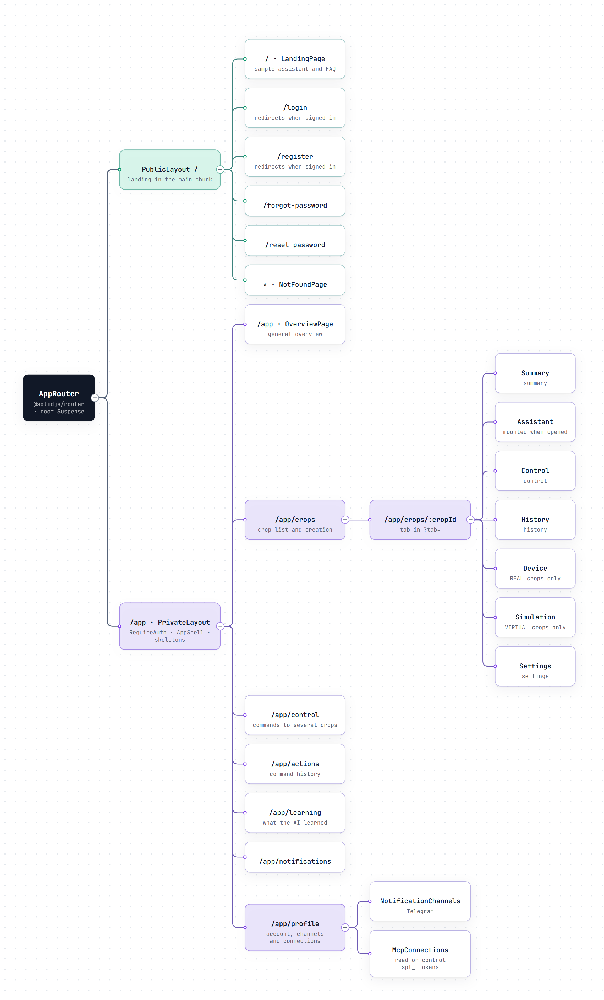
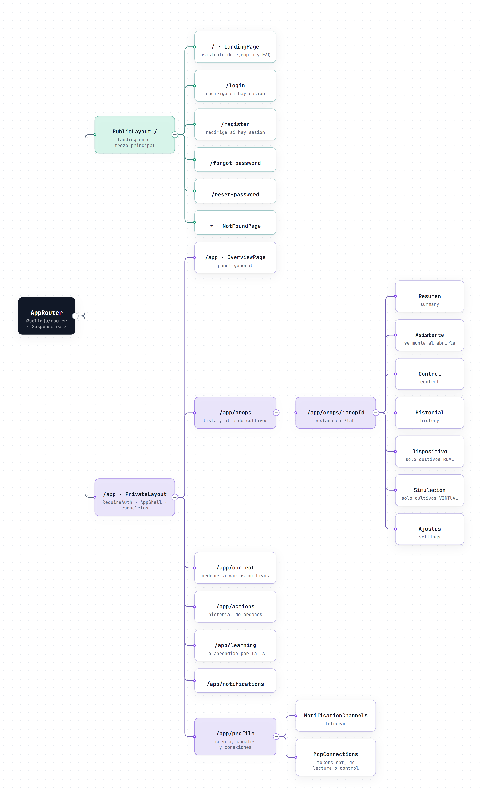

# SmartPot-Web · Interactive Diagrams

[English](#english) | [Español](#español)

---

## English

Each diagram is a self-contained HTML page that works offline. Download it and open it in a browser to zoom, search nodes, trace a path and jump to the exact source lines on GitHub. The PNG preview is the light-theme render of the same diagram.

### 1. PWA Route Map

Every route declared in `AppRouter`. The public branch (`PublicLayout`) holds the landing, which ships in the main chunk, plus sign-in, registration, password recovery and the 404 page; `/login` and `/register` redirect when a session already exists. The private branch `/app` goes through `RequireAuth` and `AppShell` and lazy-loads each view, showing a skeleton while its chunk downloads. The crop detail keeps the active tab in `?tab=`, with the Device tab only for REAL crops and Simulation only for VIRTUAL ones, and the profile hosts the Telegram channels and the MCP connections.

- Interactive: [English](SmartPot_Web_A1_Route_Map_Tree.en.html) · [Spanish](SmartPot_Web_A1_Route_Map_Tree.es.html)
- Sources: `src/app/router.tsx`, `src/app/routes.tsx`, `src/app/PrivateLayout.tsx`, `src/features/crops/CropDetailPage.tsx` and `src/features/profile/` at commit `ccc2d16`.

---

## Español

Cada diagrama es una página HTML autocontenida que funciona sin conexión. Descárgala y ábrela en un navegador para ampliar, buscar nodos, seguir un recorrido y saltar a las líneas exactas del código en GitHub. La vista previa PNG es el mismo diagrama en tema claro.

### 1. Mapa de rutas de la PWA

Todas las rutas que declara `AppRouter`. La rama pública (`PublicLayout`) contiene la landing, que va en el trozo principal, más el acceso, el registro, la recuperación de contraseña y la página 404; `/login` y `/register` redirigen si ya hay sesión. La rama privada `/app` pasa por `RequireAuth` y `AppShell` y carga cada vista bajo demanda, con un esqueleto mientras baja su trozo. El detalle del cultivo guarda la pestaña activa en `?tab=`, con Dispositivo solo para cultivos REAL y Simulación solo para VIRTUAL, y el perfil aloja los canales de Telegram y las conexiones MCP.

- Interactivo: [inglés](SmartPot_Web_A1_Route_Map_Tree.en.html) · [español](SmartPot_Web_A1_Route_Map_Tree.es.html)
- Fuentes: `src/app/router.tsx`, `src/app/routes.tsx`, `src/app/PrivateLayout.tsx`, `src/features/crops/CropDetailPage.tsx` y `src/features/profile/` en el commit `ccc2d16`.

